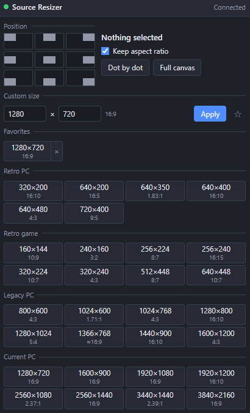

[English](README.md) | [日本語](README.ja.md) | [한국어](README.ko.md) | [Bahasa Indonesia](README.id.md) | **Français** | [繁體中文](README.zh-TW.md)

# Source Resizer for OBS

Un script Lua pour OBS Studio (Windows) avec un dock pour placer n'importe quelle source (vidéo, image, capture, texte…) d'un coin à l'autre.

- Neuf boutons collent les éléments sélectionnés au bord du canevas. Les éléments pivotés, recadrés ou délimités sont pris en charge
- Tailles en un clic : résolutions PC rétro, jeux rétro, anciens PC et PC actuels, avec leur format (4:3, 16:9…)
- Taille personnalisée en pixels et favoris
- Conserver le ratio ON / OFF
- Dot by dot et canevas entier
- Affiche la taille et le format de la sélection
- Les neuf déplacements et le dot by dot sont aussi des raccourcis (Paramètres → Raccourcis)
- Interface : English / 日本語 / 한국어 / Bahasa Indonesia / Français / 繁體中文 (autres langues d'OBS → English)

Avec Conserver le ratio ON, la source tient dans la taille choisie. Avec OFF, elle est étirée exactement à cette taille.

## Installation
1. Placez tout le dossier `Source_Resizer_for_OBS` dans `%APPDATA%\obs-studio\plugin_config\` (collez ce chemin dans la barre d'adresse de l'Explorateur pour l'ouvrir).
2. OBS → **Outils → Scripts → +** → sélectionnez `obs_source_resizer.lua`.
3. Cliquez sur **Afficher l'URL du dock**, copiez l'**URL du dock**, puis **Docks → Docks de navigateur personnalisés…** → collez-la.
4. Activez **Outils → Paramètres du serveur WebSocket** et saisissez le même port / mot de passe dans les réglages du script.

## Désinstallation
Retirez le script dans **Outils → Scripts** (sélection, puis **−**), fermez OBS, puis lancez `Safe_Uninstaller.bat`. Il indique le rôle de chaque fichier, vous laisse choisir quoi supprimer, sauvegarde vos réglages, explique le passage à un autre PC et envoie le tout à la Corbeille.

Nécessite OBS 28+ (obs-websocket v5 intégré) sous Windows.

Auteur : ChromeBread feat. BlackDream ・ Licence : GPL-2.0

Ce script tiers n'est pas officiel. Il n'est ni affilié au projet OBS ni approuvé par celui-ci.

## Mises à jour

Ce logiciel ne vérifie pas les mises à jour et ne se met pas à jour tout seul, et aucune fonction de mise à jour automatique connectée à Internet n'est prévue. Pour mettre à jour, suivez le lien du développeur et téléchargez vous-même la nouvelle version sur le site de distribution : [Releases](../../releases)
