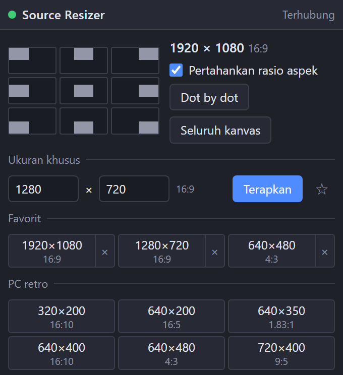

[English](README.md) | [日本語](README.ja.md) | [한국어](README.ko.md) | **Bahasa Indonesia** | [Français](README.fr.md) | [繁體中文](README.zh-TW.md)

# Source Resizer for OBS

Skrip Lua untuk OBS Studio (Windows) dengan dock untuk menata sumber apa pun (video, gambar, tangkapan, teks…) dari sudut ke sudut.

- Sembilan tombol menempelkan item terpilih ke tepi kanvas. Item yang diputar, dipotong, atau berbatas juga didukung
- Ukuran sekali klik: resolusi PC retro, game retro, PC lama, dan PC saat ini, masing-masing dengan rasio aspek (4:3, 16:9…)
- Ukuran piksel kustom dan favorit tersimpan
- Pertahankan rasio aspek ON / OFF
- Dot by dot dan seluruh kanvas
- Menampilkan ukuran dan rasio aspek pilihan saat ini
- Sembilan gerakan dan dot by dot juga tersedia sebagai hotkey (Pengaturan → Hotkey)
- UI: English / 日本語 / 한국어 / Bahasa Indonesia / Français / 繁體中文 (bahasa OBS lain → English)

Dengan Pertahankan rasio aspek ON, sumber muat di dalam ukuran yang dipilih. Dengan OFF, sumber direntangkan tepat ke ukuran itu.

## Instalasi
1. Simpan `obs_source_resizer.lua` dan `obs_source_resizer_dock.html` di folder yang sama.
2. OBS → **Alat → Skrip → +** → pilih `obs_source_resizer.lua`.
3. Tekan **Tampilkan URL Dock**, salin **URL Dock**, lalu **Dock → Dock Peramban Kustom…** → tempel.
4. Aktifkan **Alat → Pengaturan Server WebSocket** dan masukkan port / kata sandi yang sama di pengaturan skrip.

## Hapus instalasi
Hapus skrip dari **Alat → Skrip** (pilih, tekan **−**), tutup OBS, lalu jalankan `Safe_Uninstaller.bat`. Alat ini menampilkan fungsi tiap file, memungkinkan Anda memilih yang dihapus, mencadangkan pengaturan, menjelaskan cara pindah ke PC lain, dan memindahkan semuanya ke Recycle Bin.

Memerlukan OBS 28+ (obs-websocket v5 bawaan) di Windows.

Pembuat: ChromeBread feat. BlackDream ・ Lisensi: GPL-2.0

Ini adalah skrip pihak ketiga tidak resmi. Tidak berafiliasi dengan atau didukung oleh OBS Project.

## Tentang pembaruan

Perangkat lunak ini tidak memeriksa pembaruan atau memperbarui dirinya sendiri, dan tidak ada rencana menambahkan fitur pembaruan otomatis yang terhubung ke internet. Untuk memperbarui, ikuti tautan pengembang dan unduh versi baru sendiri dari situs distribusi: [Releases](../../releases)
