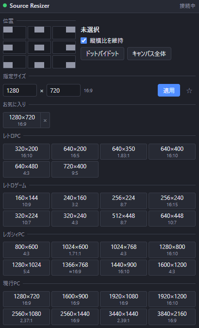

[English](README.md) | **日本語** | [한국어](README.ko.md) | [Bahasa Indonesia](README.id.md) | [Français](README.fr.md) | [繁體中文](README.zh-TW.md)

# Source Resizer for OBS

映像、画像、キャプチャ、テキストなど、あらゆるソースを隅から隅まで配置できるドック付きの OBS Studio (Windows) Lua スクリプトです。

- 9 個のボタンで、選択中のアイテムをキャンバスの端にぴったり寄せます。回転、クロップ、領域指定されたアイテムにも対応します
- ワンクリックのサイズ: レトロ PC、レトロゲーム、レガシー PC、現行 PC の解像度を縦横比 (4:3、16:9 など) 付きで表示します
- ピクセル指定とお気に入りの保存
- 縦横比の維持 ON / OFF
- ドットバイドットとキャンバス全体
- 選択中のサイズと縦横比を表示します
- 9 方向の移動とドットバイドットはホットキーにも割り当てられます (設定 → ホットキー)
- UI は English / 日本語 / 한국어 / Bahasa Indonesia / Français / 繁體中文 (他の OBS 言語は英語)

縦横比の維持が ON のときは指定サイズの内側に収まり、OFF のときはそのサイズに合わせて引き伸ばします。

## インストール
1. `Source_Resizer_for_OBS` フォルダを丸ごと `%APPDATA%\obs-studio\plugin_config\` に置きます (このパスをエクスプローラーのアドレス欄に貼り付けると開けます)。
2. OBS → **ツール → スクリプト → +** で `obs_source_resizer.lua` を選びます。
3. **ドックURLを表示** を押して **ドックURL** をコピーし、**ドック → カスタムブラウザドック…** に貼り付けます。
4. **ツール → WebSocketサーバー設定** を有効にし、同じポートとパスワードをスクリプトの設定に入力します。

## アンインストール
**ツール → スクリプト** でスクリプトを外し (選択して **−**)、OBS を閉じてから `Safe_Uninstaller.bat` を実行します。各ファイルの内容を表示し、削除するものを選べます。設定のバックアップ、別の PC への引っ越し手順の表示にも対応し、削除したものはごみ箱へ移動します。

Windows の OBS 28 以降 (obs-websocket v5 内蔵) が必要です。

製作者: ChromeBread feat. BlackDream ・ ライセンス: GPL-2.0

これは非公式のサードパーティ製スクリプトです。OBS Project とは関係がなく、承認も受けていません。

## アップデートについて

本ソフトにはアップデートの確認機能や自動更新機能はなく、今後も通信を伴う自動アップデート機能を実装する予定はありません。アップデートの際は、開発者のリンクを辿ってご自身で配布サイトからダウンロードしてください: [Releases](../../releases)
