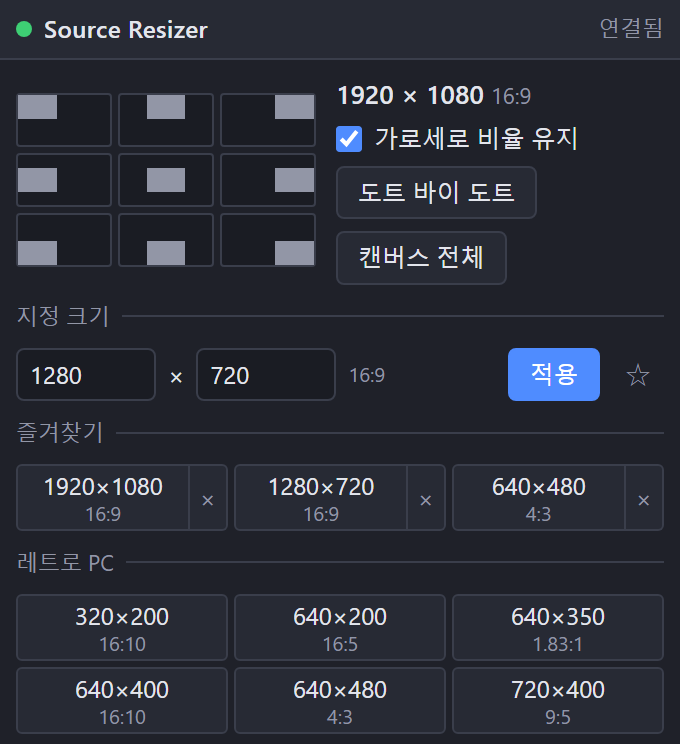

[English](README.md) | [日本語](README.ja.md) | **한국어** | [Bahasa Indonesia](README.id.md) | [Français](README.fr.md) | [繁體中文](README.zh-TW.md)

# Source Resizer for OBS

영상, 이미지, 캡처, 텍스트 등 모든 소스를 구석구석 배치할 수 있는 도크가 포함된 OBS Studio (Windows) Lua 스크립트입니다.

- 9개의 버튼으로 선택한 항목을 캔버스 가장자리에 딱 맞게 붙입니다. 회전, 자르기, 영역 지정 항목도 지원합니다
- 원클릭 크기: 레트로 PC, 레트로 게임, 레거시 PC, 현행 PC 해상도를 화면비 (4:3, 16:9 등)와 함께 표시합니다
- 픽셀 크기 지정과 즐겨찾기 저장
- 가로세로 비율 유지 ON / OFF
- 도트 바이 도트와 캔버스 전체
- 선택 항목의 크기와 화면비를 표시합니다
- 9방향 이동과 도트 바이 도트는 단축키로도 사용할 수 있습니다 (설정 → 단축키)
- UI: English / 日本語 / 한국어 / Bahasa Indonesia / Français / 繁體中文 (다른 OBS 언어는 영어)

가로세로 비율 유지가 ON이면 지정한 크기 안에 맞추고, OFF이면 그 크기로 늘립니다.

## 설치
1. `obs_source_resizer.lua`와 `obs_source_resizer_dock.html`을 같은 폴더에 둡니다.
2. OBS → **도구 → 스크립트 → +** 에서 `obs_source_resizer.lua`를 선택합니다.
3. **도크 URL 표시**를 누르고 **도크 URL**을 복사해 **도크 → 사용자 지정 브라우저 도크…** 에 붙여넣습니다.
4. **도구 → WebSocket 서버 설정**을 켜고 같은 포트와 비밀번호를 스크립트 설정에 입력합니다.

## 제거
**도구 → 스크립트**에서 스크립트를 뺀 뒤 (선택하고 **−**) OBS를 닫고 `Safe_Uninstaller.bat`을 실행합니다. 각 파일의 내용을 보여 주고 제거할 항목을 고를 수 있습니다. 설정 백업과 다른 PC로 옮기는 방법도 제공하며, 제거한 항목은 휴지통으로 이동합니다.

Windows용 OBS 28 이상 (obs-websocket v5 내장)이 필요합니다.

제작자: ChromeBread feat. BlackDream ・ 라이선스: GPL-2.0

비공식 서드파티 스크립트입니다. OBS Project와 관련이 없으며 승인을 받지 않았습니다.

## 업데이트 안내

이 소프트웨어에는 업데이트 확인이나 자동 업데이트 기능이 없으며, 앞으로도 인터넷에 연결하는 자동 업데이트 기능을 구현할 계획이 없습니다. 업데이트할 때는 개발자의 링크를 따라 배포 사이트에서 직접 내려받으세요: [Releases](../../releases)
