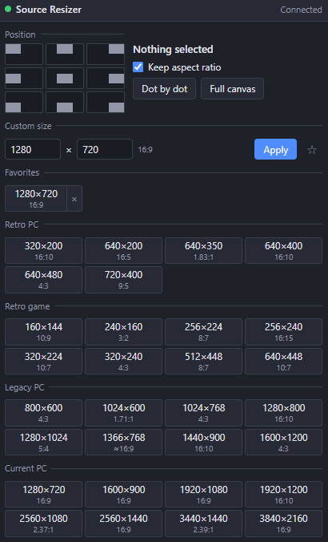

**English** | [日本語](README.ja.md) | [한국어](README.ko.md) | [Bahasa Indonesia](README.id.md) | [Français](README.fr.md) | [繁體中文](README.zh-TW.md)

# Source Resizer for OBS

An OBS Studio (Windows) Lua script with a dock for laying out any source (video, image, capture, text…) from corner to corner.

- Nine buttons push the selected items flush against the canvas edge. Rotated, cropped and bounded items work too
- One-click sizes: retro PC, retro game, legacy PC and current PC resolutions, each labeled with its aspect ratio (4:3, 16:9…)
- Custom pixel size and saved favorites
- Keep aspect ratio ON / OFF
- Dot by dot and full canvas
- Shows the size and aspect ratio of the current selection
- The nine moves and dot by dot are also hotkeys (Settings → Hotkeys)
- UI in English / 日本語 / 한국어 / Bahasa Indonesia / Français / 繁體中文 (other OBS languages → English)

With Keep aspect ratio ON, the source fits inside the chosen size. With it OFF, the source is stretched to exactly that size.

## Install
1. Keep `obs_source_resizer.lua` and `obs_source_resizer_dock.html` in the same folder.
2. OBS → **Tools → Scripts → +** → select `obs_source_resizer.lua`.
3. Press **Show Dock URL**, copy the **Dock URL**, then **Docks → Custom Browser Docks…** → paste it.
4. Enable **Tools → WebSocket Server Settings** and enter the same port / password in the script settings.

## Uninstall
Remove the script from **Tools → Scripts** (select it, press **−**), close OBS, then run `Safe_Uninstaller.bat`. It shows what each file is, lets you choose what to remove, backs up your settings, explains moving to another PC, and sends everything to the Recycle Bin.

Requires OBS 28+ (built-in obs-websocket v5) on Windows.

Author: ChromeBread feat. BlackDream ・ License: GPL-2.0

This is an unofficial third-party script. It is not affiliated with or endorsed by the OBS Project.

## Updates

This software does not check for updates or update itself, and no automatic update feature that connects to the internet is planned. To update, follow the developer's link and download the new version from the distribution site yourself: [Releases](../../releases)
