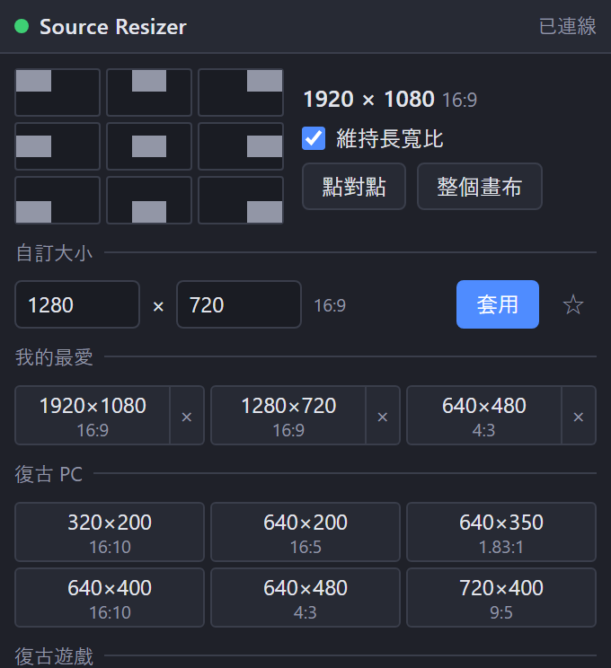

[English](README.md) | [日本語](README.ja.md) | [한국어](README.ko.md) | [Bahasa Indonesia](README.id.md) | [Français](README.fr.md) | **繁體中文**

# Source Resizer for OBS

附停駐視窗的 OBS Studio (Windows) Lua 腳本，可將影片、圖片、擷取、文字等任何來源從角落到角落自由配置。

- 九個按鈕可將選取的項目貼齊畫布邊緣，也支援旋轉、裁切與設定範圍的項目
- 一鍵尺寸：復古 PC、復古遊戲、舊型 PC 與現行 PC 解析度，並標示比例 (4:3、16:9…)
- 自訂像素尺寸與我的最愛
- 維持長寬比 ON / OFF
- 點對點與整個畫布
- 顯示目前選取項目的尺寸與比例
- 九個方向的移動與點對點也可設為快速鍵 (設定 → 快速鍵)
- 介面語言：English / 日本語 / 한국어 / Bahasa Indonesia / Français / 繁體中文 (其他 OBS 語言 → English)

維持長寬比為 ON 時，來源會收在指定尺寸內；為 OFF 時，來源會拉伸至該尺寸。

## 安裝
1. 將 `obs_source_resizer.lua` 與 `obs_source_resizer_dock.html` 放在同一資料夾。
2. OBS → **工具 → 腳本 → +** → 選擇 `obs_source_resizer.lua`。
3. 按 **顯示 Dock 網址**，複製 **Dock 網址**，然後在 **停駐視窗 → 自訂瀏覽器停駐視窗…** 貼上。
4. 啟用 **工具 → WebSocket 伺服器設定**，並在腳本設定中輸入相同的連接埠與密碼。

## 解除安裝
在 **工具 → 腳本** 移除腳本 (選取後按 **−**)，關閉 OBS，再執行 `Safe_Uninstaller.bat`。它會顯示每個檔案的用途，可選擇要移除的項目、備份設定、說明如何搬移到其他電腦，並將項目移到資源回收筒。

需要 Windows 版 OBS 28 以上 (內建 obs-websocket v5)。

製作者: ChromeBread feat. BlackDream ・ 授權: GPL-2.0

這是非官方的第三方腳本，與 OBS Project 無關，也未獲其認可。

## 關於更新

本軟體沒有檢查更新或自動更新的功能，今後也沒有實作連網自動更新功能的計畫。需要更新時，請依開發者的連結自行前往發布網站下載: [Releases](../../releases)
